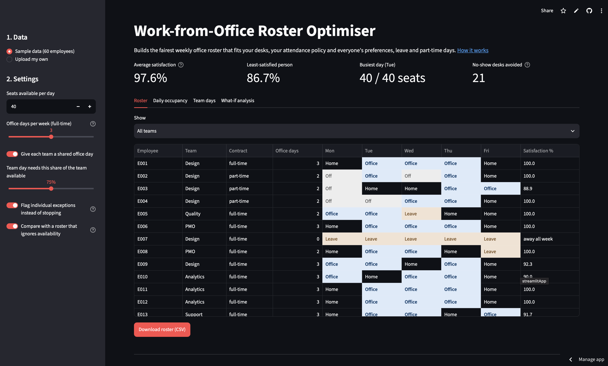

# Work-from-Office Roster Optimizer

Hybrid work creates a scheduling problem: everyone wants to come in midweek, but there are only so many desks. This project builds the best possible weekly office roster using mathematical optimisation (integer linear programming) in Python.

It is a rebuild and extension of my MBA capstone at IIM Tiruchirappalli (Best Industry Project Award, 2023), which was originally built in Excel Solver.

**[Try the live app →](https://wfo-roster-optimizer.streamlit.app)** Use the sample data or upload your own spreadsheets, adjust seats and policy, and download the roster.



## The problem

Given:
- a list of employees and their teams
- each person's preference for each weekday (1 = dislike, 5 = love)
- the number of desks available
- the company's office-attendance policy (e.g. 3 days a week)

Find the roster that gives people the days they prefer most, without exceeding seat capacity.

## How the model works

| Part | In plain terms |
|---|---|
| Decisions | For every person and every day: in the office (1) or not (0) |
| Rule: seats | People in office on any day ≤ seats available |
| Rule: attendance | Each person comes in between the minimum and maximum days |
| Goal | Maximise the total preference score across everyone |

## Results (v1, sample data: 60 employees, 40 seats, 3 days/week)

- Tuesday to Thursday fill to capacity; the model moves the overflow to Monday and Friday
- Average satisfaction: 93.1% of each person's best possible score
- Half of employees get all three of their favourite days
- But the least-satisfied person gets only 62.5%, which is the fairness problem v2 solves

## Results (v2: fairness and team days)

Version 2 adds two upgrades and compares three scenarios on the same data:

1. **Fairness:** first raise the least-satisfied person's score as high as possible, then maximise everyone's happiness without dropping below that floor (a two-stage, max-min approach).
2. **Team days:** each team gets one shared office day, and every member comes in that day.

| | v1: max happiness | + fairness | + fairness + team days |
|---|---|---|---|
| Average satisfaction | 93.1% | 93.0% | 91.1% |
| Lowest satisfaction | 62.5% | 83.3% | 81.8% |
| Got all favourite days | 30 of 60 | 25 of 60 | 19 of 60 |
| Teams with a shared day | 0 of 5 | 0 of 5 | 5 of 5 |

**What this shows:**
- Fairness lifts the worst-off employee from 62.5% to 83.3% while the average drops by only 0.1 points. The v1 roster was unfair for almost no gain.
- Guaranteeing every team a shared day costs about 2 points of average satisfaction, which leadership can weigh against the value of in-person collaboration.

## Results (v3: diagnosis and what-if analysis)

**Diagnosis.** When the rules conflict, the model explains why in plain English and suggests the smallest fix, instead of just failing. For example, with 35 seats and a 3-day policy:

```
No valid roster is possible. Why:
  - Not enough desks: 60 people x 3 days = 180 desk-days needed, but 35 seats x 5 days = 175.
    Increase seats to 36, or lower the policy to 2 days.
```

It first runs quick arithmetic checks (seat capacity, contradictory rules, teams larger than the office). If those pass but the solver still finds no roster, it tests whether team days are the blocker and searches for the smallest number of extra seats that would make a roster possible.

**What-if analysis.** The model tests 15 combinations of seat count and office policy in about 10 seconds, with fairness and team days on:


**What this shows:**
- A 3-day policy needs at least 36 seats for 60 people; a 4-day policy needs 48.
- At 40 seats, moving from a 2-day to a 3-day policy costs about 6 points of average satisfaction (97.3% to 91.1%).
- Under a 3-day policy, adding 5 seats (40 to 45) raises the average from 91.1% to 96.0% and the least-satisfied employee from 81.8% to 85.7%.
- Under a 2-day policy, the least-satisfied employee stays at 80% beyond 40 seats, so extra desks stop helping.

## Results (v4: leave, part-time staff and unavailable days)

Real weeks are messy. Version 4 reads `availability.csv`, which marks each person's weekdays as `available`, `off` (part-time), `leave` or `unavailable` (working, but can't come in), and adds four rules:

1. **Blocked days:** nobody is rostered on a day they're off, on leave or unavailable.
2. **Pro-rata targets:** office days scale with days actually worked. Under a 3-day policy, someone working 4 days (part-time or 1 day of leave) comes in 2 days; someone on leave all week comes in 0.
3. **Smarter team days:** a team's shared day must be one at least 75% of its working members can attend; members who are away that day are excused.
4. **Named diagnosis:** when no roster is possible, it names the specific person or team responsible.

**Sample week:** 60 employees, 40 seats; 9 part-time, 13 taking leave, 2 with a day they can't come in.

**Why it matters.** The v3 roster, which ignores availability, would book **21 desks for people who won't turn up**: 14 for people on leave, 6 for part-timers on their day off and 1 for someone who said they can't come in.

**With availability built in:**
- Every rule is met: no one booked on a blocked day, every target exact, no day over capacity.
- Leave and part-time free up 26 desk-days, so this week runs on as few as **31 seats**, against 36 when availability is ignored.
- Every team still gets a shared day, with absent members excused (for example, Design on Thursday: 13 of 18 in, 5 away).

**Diagnosis examples:**

```
- E020 must come in 3 days but can only attend 2 (Wed, Fri). Excuse them from one day
  or change an 'unavailable' day.
- Team Design has no day when at least 100% of its 17 working members are available.
  Lower TEAM_DAY_MIN_SHARE or skip team days this week.
```

The roster is saved to `roster_v4.csv` with readable labels (Office, Home, Leave, Off, Unavailable) so it can be shared as-is.

## v5: web app

The model now runs as a web app ([live link](https://wfo-roster-optimizer.streamlit.app)), so anyone can use it without installing Python.

- **Data:** try the built-in sample, or upload your own employees and availability CSVs (templates provided in the app).
- **Settings:** seats, office-day policy, team days and the team-day attendance threshold, all adjustable on screen.
- **Results:** headline satisfaction figures, a colour-coded roster filterable by team, daily occupancy against capacity, each team's shared day, and a downloadable CSV.
- **What-if analysis:** compare satisfaction across a range of seat counts and neighbouring office policies in one click.
- **Plain-English checks:** uploads are validated (missing columns, scores outside 1 to 5, typos in availability, duplicate IDs), and impossible settings explain what to change.
- **Exception flagging:** if someone's unavailable days stop them meeting the policy (for example, one fixed commitment under a 5-day policy), the app still builds the roster. It rosters them on every day they can attend and flags the gap as *Exception needed*, so they can request an exception from their supervisor instead of blocking everyone else's roster. Real capacity problems, like too few seats, still stop the roster with an explanation.

**Under the hood:** the model was moved into `roster_engine.py` so the app and scripts share one implementation. Rules are stored as sparse matrices and each solve has a 30-second time limit, so the app handles larger organisations; a 500-person test with leave rosters in under a minute.

Built with Python, pandas, SciPy (HiGHS solver) and Streamlit. Runs natively on Windows, Intel Macs and Apple-chip Macs.

## How to run

```
pip install -r requirements.txt
python generate_data.py
python roster_v1.py
python roster_v2.py
python roster_v3.py
python generate_availability.py
python roster_v4.py
streamlit run app.py
```

Rosters are saved to `roster.csv` (v1), `roster_v2.csv` (v2), `roster_v3.csv` (v3) and `roster_v4.csv` (v4). Version 3 also saves `scenarios.csv` and `scenarios.png`. To roster a real week, edit `availability.csv` in Excel and re-run `roster_v4.py`. Change `SEATS`, `MIN_DAYS` or `MAX_DAYS` at the top of `roster_v1.py` to test other scenarios.

## Roadmap

- [x] v1: core model (seats, attendance, preferences)
- [x] v2: fairness (lift the least-satisfied person) and team days (teammates share at least one office day)
- [x] v3: plain-English diagnosis when no roster is possible, and what-if analysis across seat counts and policies
- [x] v4: leave, part-time staff and individual unavailable days
- [x] v5: web app (Streamlit) to upload a CSV and download a roster

All data in this repository is randomly generated.
